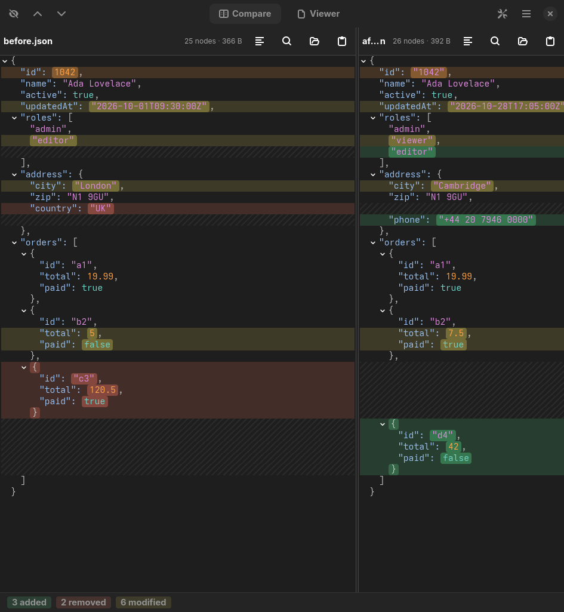
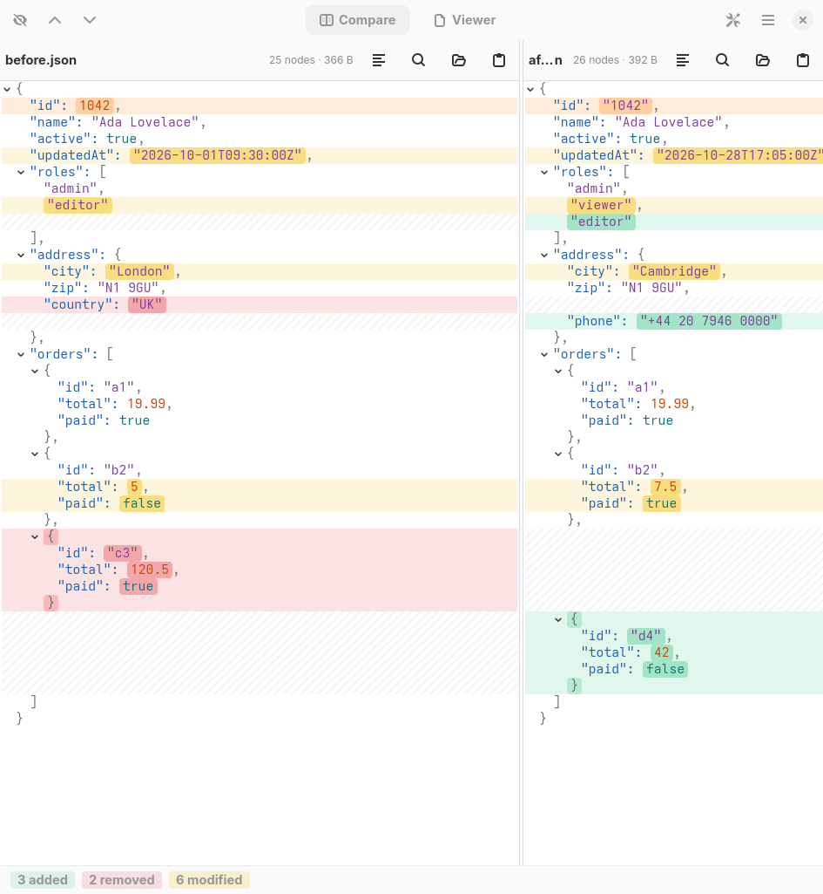
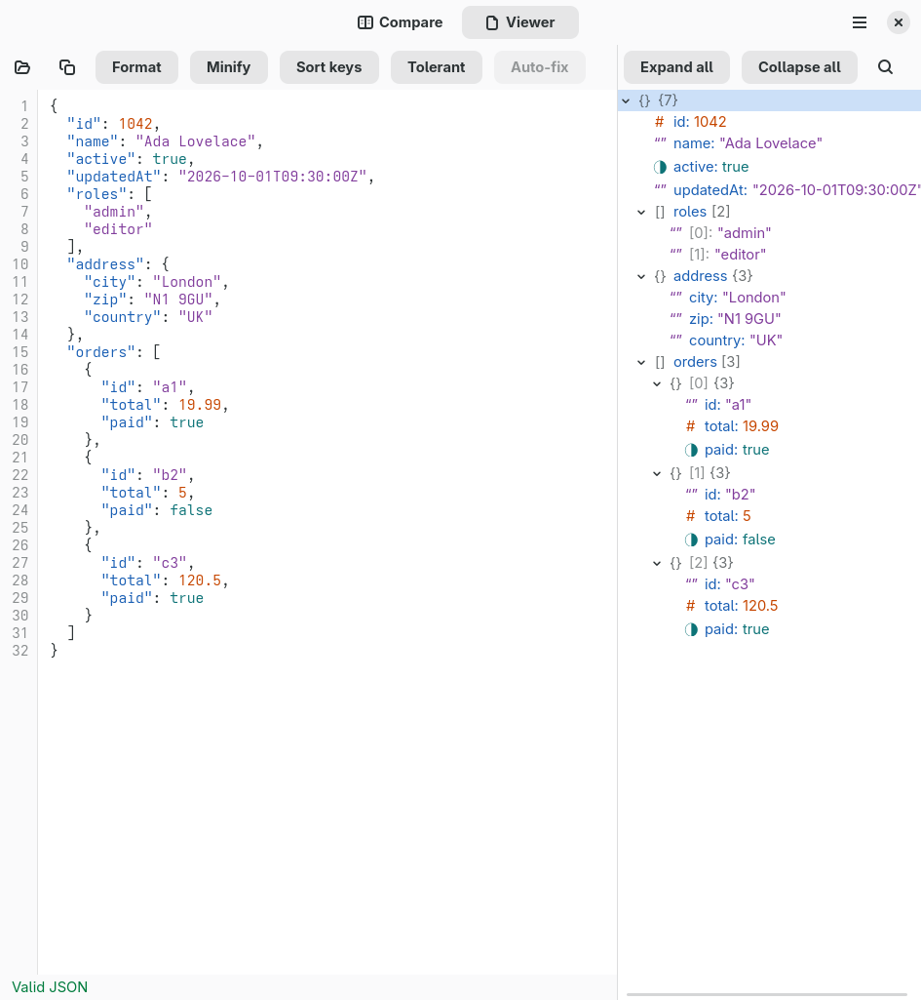
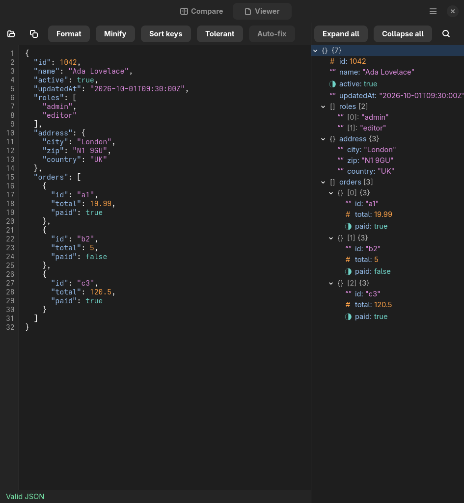

# lljson

A native Linux tool that brings together a **semantic JSON diff**, a **side-by-side visual
comparison** and **formatting utilities**. It works offline, starts fast and stays smooth with
files of a million nodes. Built with Rust, GTK4 and libadwaita.

<p align="center">
  
</p>

## Features

**Compare**
- Semantic diff: ignores key order and whitespace, and flags type changes such as `"1"` vs `1`.
- Side-by-side view with synchronized scrolling and aligned rows; added (green), removed (red)
  and modified (yellow) values are highlighted down to the exact value.
- Arrays compared by index or by a key such as `id`; ignore keys or paths such as `updatedAt`
  or `$.users[*].zip`.
- Jump between differences, collapse equal sections, summary bar with added / removed / modified.
- Open files, paste, drag and drop, or compare the clipboard against a file.
- Copy the path (`$.orders[1].total`) or the value of any node; search keys and values
  (case and accent insensitive, exact or regex).

**Viewer**
- Editable text with line numbers, syntax colors and live validation (line and column of the
  error, with a hint).
- Format, minify and sort keys; auto-format on paste.
- Virtualized tree with type icons, lengths and array indices, kept in sync with the text cursor.

**Everywhere**
- Tolerant mode: accepts trailing commas and `//` / `/* */` comments, with an auto-fix option.
- Follows the system light / dark theme, plus several named themes.
- Never blocks the UI: parsing, diffing and formatting run on background threads and the views
  are virtualized, so one widget is never created per JSON node.

<p align="center">
  
  
</p>
<p align="center">
  
</p>

The screenshots use the files in [`docs/examples`](docs/examples), so you can reproduce the first one with:

```sh
lljson docs/examples/before.json docs/examples/after.json
```

## Install

### From source

You need Rust 1.92 or newer, plus the GTK4 (4.18+) and libadwaita (1.7+) development packages.

```sh
# Arch / CachyOS
sudo pacman -S --needed rust gtk4 libadwaita pkgconf
# Fedora
sudo dnf install cargo gtk4-devel libadwaita-devel
# Debian / Ubuntu
sudo apt install cargo libgtk-4-dev libadwaita-1-dev pkg-config
```

```sh
git clone https://github.com/SebastianLl28/lljson
cd lljson
cargo build --release -p lljson
./target/release/lljson
```

The binary is `target/release/lljson`. The `.desktop` file, icons and AppStream metadata
are in [`data/`](data) if you want to install them system-wide.

### Flatpak

A manifest is provided in [`packaging/flatpak`](packaging/flatpak). It builds against the GNOME 49
runtime and was test-built and run locally with `flatpak-builder`. It needs the runtime, SDK and
Rust extension from Flathub:

```sh
flatpak install --user flathub org.gnome.Platform//49 org.gnome.Sdk//49 \
  org.freedesktop.Sdk.Extension.rust-stable//25.08
./packaging/flatpak/generate-sources.sh      # writes cargo-sources.json from Cargo.lock
flatpak-builder --user --install --force-clean build-dir \
  packaging/flatpak/io.github.sebastianll28.Lljson.yaml
flatpak run io.github.sebastianll28.Lljson
```

## Usage

```sh
lljson                       # empty window
lljson a.json b.json         # compare two files
cat a.json | lljson - b.json # read one side from standard input
```

| Compare tab | Shortcut |
|---|---|
| Open left / right | `Ctrl+O` / `Ctrl+Shift+O` |
| Paste into left / right | `Ctrl+V` / `Ctrl+Shift+V` |
| Next / previous difference | `F3` or `Alt+Down` / `Shift+F3` or `Alt+Up` |
| Hide equal sections | `Ctrl+H` |
| Comparison options (array key, ignored paths) | `Ctrl+,` |
| Compare clipboard against a file | `Ctrl+Shift+K` |
| Search / next / previous | `Ctrl+F` / `Ctrl+G` / `Ctrl+Shift+G` |

| Viewer tab | Shortcut |
|---|---|
| Open file | `Ctrl+O` |
| Copy all | `Ctrl+Shift+C` |
| Format / minify / sort keys | `Ctrl+Shift+F` / `Ctrl+Shift+M` / `Ctrl+Shift+S` |
| Search / next / previous | `Ctrl+F` / `Ctrl+G` / `Ctrl+Shift+G` |

### Command-line tool

`lljson-cli` uses the same core library, which is handy for scripts and CI:

```sh
cargo run -p lljson-cli -- diff a.json b.json --array-key id --ignore updatedAt
cargo run -p lljson-cli -- format data.json --sort-keys
cargo run -p lljson-cli -- minify data.json
```

`diff` exits with 0 if the documents are equal, 1 if they differ and 2 on error.
Run `lljson-cli --help` for every option, including `generate` for test documents.

## Performance

Measured with a 1,000,009-node file (20.7 MiB) on an Intel Core i7-1355U:

| Metric | Goal | Result |
|---|---|---|
| Parsing | < 1 s | 53 ms |
| Diff of two nearly identical files | < 500 ms | 8 ms (72 ms end to end) |
| Memory with both files loaded | < 500 MB | ~158 MiB core, ~240–270 MiB app |
| App startup | < 300 ms | ~210 ms |
| Scrolling | 60 fps | ~59 fps |

Details and how to reproduce them: [BENCHMARKS.md](BENCHMARKS.md).

## Project layout

| Path | What it is |
|---|---|
| `crates/core` | Library: parser, arena tree, hashing, formatter, diff. No UI dependencies. |
| `crates/cli` | `lljson-cli` binary built on `core`. |
| `crates/app` | The GTK4 / libadwaita app (`lljson`). |
| `SPEC.md`, `TASKS.md` | Architecture, pinned dependency versions and work plan. |

Development checks:

```sh
cargo build --workspace
cargo test --workspace
cargo clippy --workspace --all-targets -- -D warnings
```

## License

[MIT](LICENSE) © 2026 SebastianLl28
